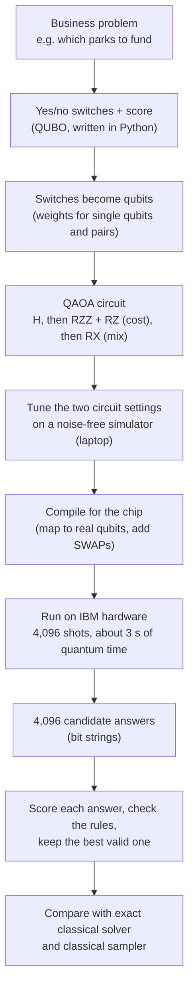
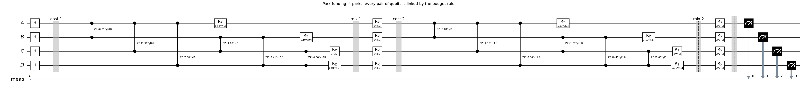
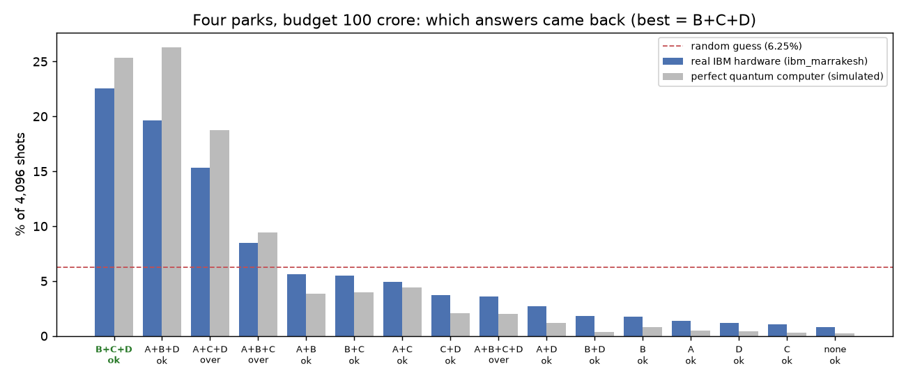
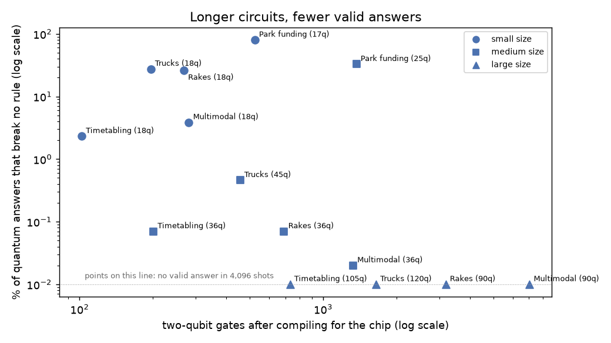

# Five freight and corridor planning problems on a real quantum computer

October 2026

## What we did and what we found

We took five planning problems from Indian freight and industrial-corridor work, wrote each one as a QUBO (a list of yes/no switches with a score), and ran them on IBM's 156-qubit Heron processors using QAOA. Each quantum run was compared with two classical methods working on exactly the same QUBO:

- an exact solver (Google OR-Tools CP-SAT), which finds the best answer and proves it is the best, and
- a classical sampler (simulated annealing), which, like the quantum computer, returns many candidate answers. We gave it the same number of samples as the quantum run, 4,096.

Short version: all five problems ran successfully on real quantum hardware, with strong results at around 20 qubits and a clear picture of what limits larger runs today. Classical methods remain the benchmark at these sizes.

1. Answer quality. At 17 to 18 qubits both classical methods found the best answer to all five problems. The quantum computer found it for two (rakes and timetabling) and came within 1% to 7% on the other three. At 25 to 45 qubits the classical methods still found the best answers or came within 0.5%, while the quantum computer's best answers were 8% to 29% worse, and six times worse on timetabling. At 90 to 120 qubits the quantum computer returned no valid answer at all.
2. Valid answers. Nearly all classical sampler answers were valid (95% to 100%, with one exception noted at large size). On the quantum computer the share was 2% to 80% at small size, 0.02% to 33% at medium size, and zero at large size.
3. Time. The exact solver needed well under a second for almost everything; the exceptions were park funding and large multimodal routing, where it found a good answer at once but could not prove it optimal within 60 seconds. The classical sampler took 0.4 to 5 seconds on a laptop. Each quantum job used about 3 seconds of quantum time, plus queue waits that ran from a few seconds to over an hour on IBM's free plan.
4. The quantum computer is doing real optimisation work. It moves its answers 51% to 77% of the way from random guessing toward the best answer at small size, and it gets 73% to 88% of what a perfect noise-free quantum computer would get with the same circuit. In other words, at this size the hardware is already close to what the algorithm can deliver.
5. The trend with size is clear. As circuits pass a few hundred two-qubit gates, the quantum answers fall further behind, and at around 100 qubits none of them are valid.
6. We made one mistake on the way that is worth knowing about. Our first full run picked the circuit settings by a coarse sweep on the hardware, and those settings turned out to be no better than random even on a perfect, noise-free simulator. The results looked like "hardware is just noise", which was wrong. Tuning the settings on a classical simulator first fixed it.

Problems of 20 to 50 switches are well within reach of classical computers, and current quantum hardware is still noisy, so classical leading at this stage is expected. The aim of the exercise was to get the problems running on real hardware, measure how far today's machines get, understand what limits them, and have the formulations and code ready as hardware improves.

All data is synthetic, generated by fixed random seeds, but shaped like the real problems. No government data was used or sent anywhere.

## The five problems

Each problem is a set of yes/no decisions. A rule that must not be broken (for example "a truck can take only one load") is turned into a penalty: break the rule and the score gets much worse. The computer then looks for the switch settings with the lowest score.

### 1. Park funding (BHAVYA-style investment)

A fixed budget has to be spread over a list of industrial parks. Each park has a cost and an expected benefit. Two parks on the same corridor partly compete for the same port and rail capacity, so funding both gives a bit less than the sum of their benefits.

- One switch per park: fund it or not.
- Goal: highest total benefit.
- Rule: total cost must not exceed the budget. This is the hard part for a QUBO, because "less than or equal to" has to be written with extra "slack" switches (5 or 6 of them here) that soak up unused budget. The budget rule touches every pair of parks, so the problem is fully connected.

Sizes run: 4 parks (warm-up), 12 parks (17 qubits), 20 parks (25 qubits), 30 parks (36 qubits).

### 2. Truck backhaul

Trucks have just unloaded at a hub and would otherwise drive back empty. Return loads are waiting nearby.

- One switch per sensible truck and load pair (we only keep each truck's 3 nearest loads, so most pairs never become switches).
- Goal: carry as many loads as possible, with as few empty kilometres as possible. Each load carried is worth 100 points, and each empty kilometre costs 1 point.
- Rules: a truck takes at most one load, and a load gets at most one truck. "At most one" is cheap to write: just a penalty on each pair of clashing switches, no slack switches needed.

Sizes run: 3 trucks (warm-up, 9 qubits), 6 trucks (18 qubits), 15 trucks (45 qubits), 40 trucks (120 qubits).

### 3. Empty rakes on a dedicated freight corridor

Empty rakes (trains of wagons) are spread along a 300 km stretch of a dedicated freight corridor. Loading requests come from four terminals, each in one of three time slots.

- One switch per rake and request pair (3 nearest requests per rake).
- Goal: earn revenue from tons moved, minus empty running distance.
- Rules: a rake serves at most one request, a request gets at most one rake, and a terminal can load only one rake in a given time slot. The last rule is what makes this different from the truck problem.

Sizes run: 6 rakes (18 qubits), 12 rakes (36 qubits), 30 rakes (90 qubits).

### 4. Conflict-free timetabling

Freight trains want to enter a single block section at certain times. Each train can leave on time, 10 minutes late, or 20 minutes late. Two trains in the same 10-minute window is a conflict.

- Three switches per train, one for each departure option.
- Goal: least total delay, where higher-priority trains count more.
- Rules: each train picks exactly one option, and no two trains share a window.

Sizes run: 6 trains (18 qubits), 12 trains (36 qubits), 35 trains (105 qubits).

### 5. Multimodal routing

Each shipment can go by road, by rail, or by rail with a last stretch on road. Road is the most expensive per ton-km but has no terminal handling. Rail is cheapest but the shared rail path gets congested, so every pair of shipments that both use rail adds a congestion cost.

- Three switches per shipment, one per mode.
- Goal: lowest total cost including congestion.
- Rule: each shipment picks exactly one mode.

The congestion term links every rail shipment to every other one, so this problem is densely connected, like park funding.

Sizes run: 6 shipments (18 qubits), 12 shipments (36 qubits), 30 shipments (90 qubits).

## How a problem gets solved, step by step

Every problem in this report goes through the same pipeline. The quantum computer only does one step of it. Everything before and after runs on an ordinary computer.



The sections below walk through this with the smallest example, four parks, which also ran on real hardware.

### Step 1: the business problem

A budget of 100 crore and four candidate parks:

| Park | Cost (crore) | Benefit score |
|---|---|---|
| A | 40 | 8 |
| B | 30 | 5 |
| C | 50 | 9 |
| D | 20 | 4 |

There are 2 x 2 x 2 x 2 = 16 possible funding choices. The best one that fits the budget is B + C + D: it costs exactly 100 and gives a benefit of 18. (A + C gives 17, and A + C + D would give 21 but costs 110.)

### Step 2: switches and a score (the QUBO)

Each park gets one switch: 1 means fund it, 0 means do not. The score has to be lowest for the best choice, so benefit counts as negative. The budget rule is added as a penalty on the leftover budget, which needs no extra switches for this small case. Multiplying everything out gives these numbers (printed by `make_figures.py`):

| Term | Value |
|---|---|
| constant | 180 |
| switch A on | -128 |
| switch B on | -101 |
| switch C on | -149 |
| switch D on | -72 |
| A and B both on | +48 |
| A and C both on | +80 |
| A and D both on | +32 |
| B and C both on | +60 |
| B and D both on | +24 |
| C and D both on | +40 |

Check for B + C + D: 180 - 101 - 149 - 72 + 60 + 24 + 40 = -18, which is minus the benefit of 18. Every pair of parks has a number because the budget links all of them. That detail matters later.

The larger problems are built the same way with a small helper class. The two rule types used everywhere look like this (from `usecases.py`):

```python
def square(self, terms, target, weight):
    """weight * (sum c_k x_k - target)^2  (x^2 = x for binaries)"""
    self.const += weight * target ** 2
    for a, c in terms:
        self.L(a, weight * (c * c - 2 * target * c))
    for (a, ca), (b, cb) in itertools.combinations(terms, 2):
        self.Q(a, b, weight * 2 * ca * cb)

def at_most_one(self, vs, weight):
    for a, b in itertools.combinations(vs, 2):
        self.Q(a, b, weight)
```

`square` is used for "exactly one option" and for the budget (with slack switches). `at_most_one` is used for "a truck takes at most one load" and similar rules. It only adds a penalty for each pair of switches that clash, which is much cheaper.

### Step 3: from switches to qubits

A qubit is measured as 0 or 1, just like a switch, but inside the circuit it is easier to work with spins of +1 and -1. The code rewrites each switch x as (1 - z) / 2, where z is the spin, and collects the result into one weight per qubit and one weight per pair, scaled so the largest is 1 (from `qaoa_suite.py`):

```python
def ising(p):
    h = -p["lin"] / 2
    J = {}
    for (i, j), c in p["quad"].items():
        h[i] -= c / 4
        h[j] -= c / 4
        J[(i, j)] = c / 4
    scale = max(np.abs(h).max(), max((abs(v) for v in J.values()), default=0))
    return h / scale, {k: v / scale for k, v in J.items()}, scale
```

### Step 4: the QAOA circuit

The circuit is built directly from those weights:

```python
def qaoa_circuit(p, reps=1):
    n = p["n"]
    h, J, _ = ising(p)
    betas, gammas = ParameterVector("b", reps), ParameterVector("g", reps)
    qc = QuantumCircuit(n)
    qc.h(range(n))                                    # every answer equally likely
    for layer in range(reps):
        for (i, j), c in J.items():
            qc.rzz(2 * gammas[layer] * c, i, j)       # pair weights
        for i in range(n):
            if abs(h[i]) > 1e-12:
                qc.rz(2 * gammas[layer] * h[i], i)    # single weights
        qc.rx(2 * betas[layer], range(n))             # mixing
    qc.measure_all()
    return qc, list(betas) + list(gammas)
```

Here is the four-park circuit with two layers, as it ran on the hardware. Each wire is one park.



Reading it from left to right:

1. H on every wire puts each park into an equal mix of "fund" and "do not fund", so all 16 choices start out equally likely.
2. Cost block. The ZZ boxes, one for each pair of parks, apply the pair weights from step 2. The RZ boxes apply the single-park weights. Together they give each of the 16 choices a phase that depends on its score. The number in each box is the weight; γ is the first circuit setting.
3. Mix block. RX on every wire, set by β (the second setting), lets the 16 choices interfere. Choices whose phases line up get more likely and the others get less likely.
4. The cost and mix blocks repeat once more (layer 2), then every wire is measured. One measurement gives one funding choice.

For comparison, here is the three-truck, three-load problem. It has nine switches (truck i takes load j), but only switches that clash are linked: the same truck or the same load.


This is the difference between the two kinds of problem in this report. Park funding and multimodal routing are dense: every switch is linked to every other. Trucks, rakes and timetabling are sparse: each switch is linked to only a few others. Dense problems need many more ZZ gates.

### Step 5: tuning the two settings

The circuit has two settings per layer, γ and β, and the result depends heavily on them. For problems up to 20 qubits we find good values on a laptop by simulating the circuit without noise and adjusting γ and β until the average score is as low as possible. This step is free and takes under a second for the small problems. It also tells us what a perfect quantum computer would return, which we use as a reference.

For larger problems the circuit is too big to simulate, so we reuse the settings found for the small version of the same problem.

### Step 6: compiling for the chip

The IBM chip connects each qubit to only two or three neighbours. The compiler places the circuit's qubits on the chip and, whenever a ZZ gate needs two qubits that are not neighbours, inserts SWAP operations to bring them together. Each SWAP costs three two-qubit gates. The four-park circuit has 12 ZZ gates on paper but became 42 two-qubit gates (circuit depth 126) on `ibm_marrakesh`, because every park is linked to every other.

### Step 7: running on the hardware

The compiled circuit, with the tuned settings filled in, is sent to IBM and run 4,096 times:

```python
sampler = SamplerV2(mode=backend)
job = sampler.run([(compiled_circuit, settings)], shots=4096)
counts = job.result()[0].data.meas.get_counts()     # {"1110": 925, "1011": 804, ...}
```

Each key in `counts` is one funding choice, read right to left (so "1110" is A=0, B=1, C=1, D=1, which is B + C + D), and the value is how many of the 4,096 shots gave it. This is what came back from `ibm_marrakesh` (job `dbb144hgv2cc73e7jld0`):



The most common answer was B + C + D, the true best, at 22.6% of shots. A random guess would be right 6.25% of the time. The grey bars show what a perfect, noise-free machine would return with the same circuit. The real hardware follows it closely, with a little probability leaking into the poorer choices on the right, which is what noise does. The next most common answers are A + B + D (benefit 17, within budget) and A + C + D (over budget, but its high benefit makes it look attractive to the circuit).

### Step 8: reading off the answer and checking it

The 4,096 answers are scored on the laptop. Any that break a rule are set aside, and the best valid one is the quantum computer's answer. That answer is then compared with the exact classical solver and the classical sampler on the same QUBO. Those comparisons are the result tables later in this report.

### Circuit size and results

The pattern across the 14 hardware runs of the five problems is easy to see when the number of two-qubit gates after compiling is plotted against the share of quantum answers that break no rule:



Up to a few hundred two-qubit gates, a useful share of the answers is valid. Past about a thousand, almost none are. Two things push a problem to the right on this chart: more switches, and denser links between them. That is why park funding at 25 qubits still gave a third valid answers (its budget rule is easy to satisfy by chance), while multimodal routing at 36 qubits gave almost none.

## How we ran it

Hardware: IBM Quantum Platform, free Open Plan, processor `ibm_marrakesh` (156 qubits, Heron family), October 19, 2026. Jobs submitted late in the day went to `ibm_kingston`, a second processor of the same type, because of queue times; each result in `results/` records which machine it ran on.

For each problem and size:

1. Exact answer. OR-Tools CP-SAT solved the same QUBO to proven optimality (60 second limit). Where it could not prove optimality in time, the table says so.
2. Classical sampler. Simulated annealing (`dwave-samplers`, default settings) on the same QUBO, 4,096 samples, run on a MacBook. This is the like-for-like comparison: a classical method that also returns many candidate answers. Code in `compare_classical.py`.
3. Random guessing. 4,096 random bit strings, scored the same way. This is not a competitor; it is a sanity check. If the quantum computer does no better than this, it is not doing anything at all.
4. Circuit settings. For problems of 20 qubits or fewer we tuned gamma and beta on a noise-free simulator on a laptop, which costs nothing. That also tells us what a perfect quantum computer would score with the same circuit. For bigger problems we cannot simulate the circuit, so we reused the settings tuned on the small version of the same problem.
5. Real hardware. The tuned circuit was compiled for the chip and run once with 4,096 shots.

What the numbers in the tables mean:

- Progress. Take the average score of the random guesses as 0% and the best possible score as 100%. Progress is where the quantum computer's average answer lands on that scale. 0% means no better than guessing.
- Valid answers. The share of samples that break no rule at all.
- Best IBM answer. The best valid answer among the 4,096 hardware samples, in the problem's own units (benefit, score, minutes of delay, or cost). No classical clean-up applied.
- Perfect QC. The progress a noise-free quantum computer would get from the same one-layer circuit.

The code also reports a "polished" result, where a simple classical routine flips single bits on the best samples until it cannot improve them. We do not use the polished numbers for any claim about the quantum computer, because the same routine applied to random guesses often reaches the same answer. At this size the clean-up step is doing most of the work.

## Results

### Warm-up runs

Before the five-problem suite we ran the two smallest examples we use for explaining the idea.

Four parks, budget 100 crore (4 qubits). The best choice is to fund parks B, C and D. On `ibm_marrakesh` this was the single most common answer, returned 22.6% of the time. A perfect quantum computer with the same circuit would return it 25.4% of the time, and a random guess is right 6.25% of the time. Job `dbb144hgv2cc73e7jld0`.

Three trucks and three loads (9 qubits). The best assignment (T1 to A, T2 to B, T3 to C, 30 empty km) appeared in 1.05% of samples, against 0.2% for random guessing and 1.57% for a perfect quantum computer. Job `dbb13e9gv2cc73e7jjog`.

In both cases the real hardware got most of the way to what a perfect machine would do.

### Small size (17 to 18 qubits)

Quantum against classical, same QUBO, 4,096 samples each:

| Use case | Exact classical answer (time) | Classical sampler best (time) | Quantum best | Valid answers: classical / quantum | Hits the best answer: classical / quantum |
|---|---|---|---|---|---|
| Park funding | 29 (0.17 s) | 29 (0.82 s) | 27 | 99.37% / 80.03% | 0.37% / 0.0% |
| Truck backhaul | 416.8 (0.005 s) | 416.8 (0.73 s) | 413 | 100.0% / 27.51% | 9.42% / 0.0% |
| DFC rakes | 928.6 (0.005 s) | 928.6 (0.74 s) | 928.6 | 100.0% / 26.29% | 14.92% / 0.049% |
| Timetabling | 10 (0.005 s) | 10 (0.55 s) | 10 | 97.02% / 2.32% | 1.2% / 0.024% |
| Multimodal routing | 80.1 (0.006 s) | 80.1 (0.4 s) | 82.2 | 100.0% / 3.86% | 1.59% / 0.0% |

How the quantum computer compares with random guessing and with a perfect quantum computer:

| Use case | Qubits | 2-qubit gates | Progress, perfect QC | Progress, IBM | Valid answers, random | Valid answers, IBM | Best IBM answer | Best possible |
|---|---|---|---|---|---|---|---|---|
| Park funding | 17 | 524 | 85.9% | 72.7% | 26.81% | 80.03% | 27 | 29 |
| Truck backhaul | 18 | 196 | 81.5% | 70.8% | 0.32% | 27.51% | 413 | 416.8 |
| DFC rakes | 18 | 268 | 90.1% | 77.4% | 0.17% | 26.29% | 928.6 | 928.6 |
| Timetabling | 18 | 102 | 65.8% | 57.9% | 0.05% | 2.32% | 10 | 10 |
| Multimodal routing | 18 | 281 | 70.5% | 51.2% | 0.24% | 3.86% | 82.2 | 80.1 |

At this size the classical sampler found the best answer every time, with almost all of its samples valid, and the quantum computer matched it on two problems. This is also the clearest quantum result in the report. On every problem the hardware is far better than guessing, and it keeps 73% to 88% of the progress a perfect machine would make. Valid answers jump from almost none with random guessing to between 2% and 80%. For rakes and timetabling the hardware's best sample is the proven best answer. Multimodal routing lost the most to noise, which fits with it having one of the denser circuits.

### Medium size (25 to 45 qubits)

Quantum against classical:

| Use case | Exact classical answer (time) | Classical sampler best (time) | Quantum best | Valid answers: classical / quantum | Hits the best answer: classical / quantum |
|---|---|---|---|---|---|
| Park funding | 49 (60 s, not proven) | 49 (1.34 s) | 44 | 99.73% / 32.79% | 0.07% / 0.0% |
| Truck backhaul | 1290 (0.006 s) | 1290 (1.84 s) | 916.3 | 100.0% / 0.46% | 0.76% / 0.0% |
| DFC rakes | 1798.1 (0.004 s) | 1798.1 (1.53 s) | 1328.2 | 99.83% / 0.07% | 0.12% / 0.0% |
| Timetabling | 30 (0.016 s) | 30 (1.1 s) | 180 | 94.73% / 0.07% | 0.1% / 0.0% |
| Multimodal routing | 207.5 (0.047 s) | 208.5 (0.85 s) | 223.4 | 100.0% / 0.02% | 0.0% / 0.0% |

Against random guessing:

| Use case | Qubits | 2-qubit gates | Progress, perfect QC | Progress, IBM | Valid answers, random | Valid answers, IBM | Best IBM answer | Best possible |
|---|---|---|---|---|---|---|---|---|
| Park funding | 25 | 1369 | n/a | 39.9% | 21.8% | 32.79% | 44 | 49 (not proven) |
| Truck backhaul | 45 | 456 | n/a | 56.9% | 0.0% | 0.46% | 916.3 | 1290 |
| DFC rakes | 36 | 691 | n/a | 56.0% | 0.0% | 0.07% | 1328.2 | 1798.1 |
| Timetabling | 36 | 201 | n/a | 59.3% | 0.0% | 0.07% | 180 | 30 |
| Multimodal routing | 36 | 1327 | n/a | 46.7% | 0.0% | 0.02% | 223.4 | 207.5 |

At this size the classical methods pull ahead. The classical sampler found the best answer, or came within 0.5% of it, on all five problems in under 2 seconds, with 95% to 100% of its samples valid. The quantum computer's best answers were 8% to 29% worse on four problems, and on timetabling its best valid timetable had six times the delay of the best one (180 minutes against 30). Valid answers fell to between 0.02% and 33% of samples.

The quantum circuit settings here were not tuned for these instances; they were copied from the small versions, because circuits this size cannot be simulated on a laptop. The hardware still moves its average answer 40% to 59% of the way from random toward the best, so it is not just producing noise. Park funding suffers most from noise, since 1,369 two-qubit gates is a lot for 25 qubits.

Park funding, trucks and rakes ran on `ibm_marrakesh`. Timetabling and multimodal routing ran on `ibm_kingston` (same processor family, also 156 qubits) after the Marrakesh queue grew long. The first multimodal job on Kingston failed with an IBM internal error (code 9705) and was resubmitted.

### Large size (90 to 120 qubits)

Quantum against classical:

| Use case | Exact classical answer (time) | Classical sampler best (time) | Quantum best | Valid answers: classical / quantum | Hits the best answer: classical / quantum |
|---|---|---|---|---|---|
| Truck backhaul | 3349.2 (0.01 s) | 3335.9 (4.77 s) | infeasible | 100.0% / 0.0% | 0.0% / 0.0% |
| DFC rakes | 3228.6 (0.01 s) | 3226.5 (3.79 s) | infeasible | 99.95% / 0.0% | 0.0% / 0.0% |
| Timetabling | 140 (0.008 s) | 220 (3.33 s) | infeasible | 42.21% / 0.0% | 0.0% / 0.0% |
| Multimodal routing | 642.3 (60 s, not proven) | 662.6 (2.74 s) | infeasible | 100.0% / 0.0% | 0.0% / 0.0% |

Against random guessing:

| Use case | Qubits | 2-qubit gates | Progress, perfect QC | Progress, IBM | Valid answers, random | Valid answers, IBM | Best IBM answer | Best possible |
|---|---|---|---|---|---|---|---|---|
| Truck backhaul | 120 | 1649 | n/a | 58.0% | 0.0% | 0.0% | infeasible | 3349.2 |
| DFC rakes | 90 | 3184 | n/a | 47.1% | 0.0% | 0.0% | infeasible | 3228.6 |
| Timetabling | 105 | 731 | n/a | 58.0% | 0.0% | 0.0% | infeasible | 140 |
| Multimodal routing | 90 | 7036 | n/a | 28.8% | 0.0% | 0.0% | infeasible | 642.3 (not proven) |

At this size, none of the 4,096 quantum samples fully satisfied every rule on any of the four problems. The circuit is still pushing in the right direction: its average answer was 29% to 58% of the way from random toward the best. This is where noise on today's processors sets the limit for these problems, and it is the point to watch as hardware improves.

The classical methods handled this size comfortably. The exact solver needed about a hundredth of a second for trucks, rakes and timetabling. On multimodal routing it found an answer of 642.3 but could not prove it optimal within 60 seconds. The classical sampler came within 0.4% on trucks, 0.1% on rakes and 3.2% on multimodal routing. Timetabling was the one case where the plain sampler struggled too (best 220 minutes of delay against 140, with 42% of samples valid), which shows that a simple sampler with default settings is not the strongest classical method. The exact solver still handled it instantly.

All four large runs were on `ibm_kingston`. Park funding was left out at this size: 30 parks (36 qubits, fully connected) compiles to about 3,500 two-qubit gates, and the medium result already showed what happens at a third of that.

### The first attempt, and why it looked wrong

Our first run of the full suite chose gamma and beta by trying 20 combinations directly on the hardware (512 shots each) and keeping the best. The results were close to random guessing almost everywhere, and it would have been easy to conclude that the hardware was too noisy.

Before writing that down we checked the same 20 settings on a noise-free simulator. The best of them was also no better than random, even with no noise at all. The good settings for these problems sit outside the grid we had picked (for example beta near -0.54 or near 2.6, where our grid only went from 0.2 to 0.8). After tuning on the simulator, the same hardware gave the much better numbers above. The first run's results are kept in `results/v1_grid_sweep/` for reference.

The lesson: a poor QAOA result on hardware should be checked against a noise-free simulation of the same circuit before blaming the hardware.

### Earlier non-quantum comparison

Before getting hardware access we ran the 100-park and 20-truck versions on a laptop simulated annealer and on Fixstars Amplify AE, a GPU-based annealer that imitates quantum annealing (it is not a quantum computer). Amplify AE got within 0.5% of the best park funding answer in 1 second and found the exact best truck assignment. These numbers are in `RESULTS.md` and `results/amplify_ae.json`. They show what quantum-inspired hardware does at full size today, but they say nothing about real quantum hardware.

## What this means

What worked: all five problems can be written as QUBOs, compiled to a real chip and run in a few seconds of quantum time each. At around 18 qubits the hardware result is clearly real. It is not luck, because it lines up with what a noise-free machine would do.

Where classical is still ahead: a laptop simulated annealer, given the same 4,096 samples, found the best or near-best answer to every problem we ran, with almost all of its samples valid, in a few seconds, and the exact solver found proven best answers almost instantly for most of them. The quantum results fall off as problems grow, for two reasons that both improve with better hardware:

1. Gate count. Dense problems (park funding, multimodal) need many SWAPs on this chip, and each extra two-qubit gate adds error.
2. Rules as penalties. Most random bit strings break some rule, and QAOA with one layer only shifts the odds a little. Valid answers become rare as the number of switches grows.

What would help next, roughly in order of expected payoff:

- Run the same QUBOs on a quantum annealer (D-Wave). Annealers handle hundreds to a few thousand switches and do not need long gate sequences. This needs a paid plan or an accepted application to D-Wave's LaunchPad programme, because the free D-Wave trial does not give an API key. The code for this is already in `run.py`.
- Use two or three QAOA layers on the small problems. On a noise-free simulator, three layers lifted progress from 66% to 72% on timetabling and from 71% to 93% on multimodal routing. Whether real hardware keeps that gain is an open question.
- Write rules in ways that need fewer gates, for example ordering the qubits so that clashing pairs sit next to each other on the chip.
- Use IBM's error mitigation options, which cost more quantum time per run.

## Quantum time used

The IBM free plan gives 10 minutes of quantum time per 28 days. Every job in this report took about 3 seconds of quantum time. Waiting time was much longer, mostly spent in IBM's public queue.

In total the account used 153 seconds of the 600 available, including the first grid-sweep attempt and one job that failed on IBM's side. The longest single queue wait was over an hour.

IBM job ids, for anyone who wants to look up the raw data:

| Run | Use case | IBM job id |
|---|---|---|
| small | Park funding | dbb1bgoc77vs7383ihvg |
| small | Truck backhaul | dbb1bkgc77vs7383ii5g |
| small | DFC rakes | dbb1bo8c77vs7383iib0 |
| small | Timetabling | dbb1bs1gv2cc73e7k57g |
| small | Multimodal routing | dbb1bvgc77vs7383iimg |
| medium | Park funding | dbb1cj7i0auc7392pedg |
| medium | Truck backhaul | dbb1crc24mrc73865n90 |
| medium | DFC rakes | dbb1d9oc77vs7383ikhg |
| medium | Timetabling | dbb1n7vi0auc7392puk0 |
| medium | Multimodal routing | dbb3la8c77vs7383luqg |
| large | Truck backhaul | dbb3h9424mrc73868t0g |
| large | DFC rakes | dbb3ipfi0auc7392spfg |
| large | Timetabling | dbb3j5pgv2cc73e7ne6g |
| large | Multimodal routing | dbb3jpni0auc7392sqkg |
| warm-up | 4 parks | dbb144hgv2cc73e7jld0 |
| warm-up | 3 trucks | dbb13e9gv2cc73e7jjog |

## Reproducing the runs

```
python3.12 -m venv .venv
.venv/bin/pip install -r requirements.txt

# save your own IBM Quantum key once (asks for it, nothing is printed)
.venv/bin/python run_ibm.py --save-key

# warm-up examples
.venv/bin/python run_ibm.py --mode qpu

# the five use cases: small first, because the larger sizes reuse its settings
.venv/bin/python qaoa_suite.py --size small
.venv/bin/python qaoa_suite.py --size medium
.venv/bin/python qaoa_suite.py --size large

# classical sampler comparison, then rebuild the tables
.venv/bin/python compare_classical.py
.venv/bin/python make_tables.py
```

Files:

- `usecases.py`: the five problems as QUBOs, at three sizes.
- `qaoa_suite.py`: exact solver, random baseline, angle tuning, circuit building and the IBM runs.
- `compare_classical.py`: simulated annealing on the same QUBOs with the same sample count.
- `run_ibm.py`: the 4-park and 3-truck warm-up examples.
- `problems.py`, `run.py`: the larger D-Wave versions (simulator tested; QPU run needs a D-Wave token).
- `run_amplify.py`: the Fixstars Amplify AE comparison.
- `make_figures.py`: the circuit diagrams and charts in `figures/`.
- `results/`: raw output of every run as JSON.
